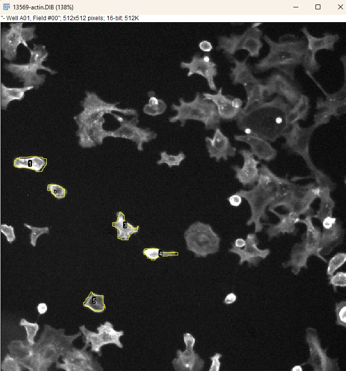
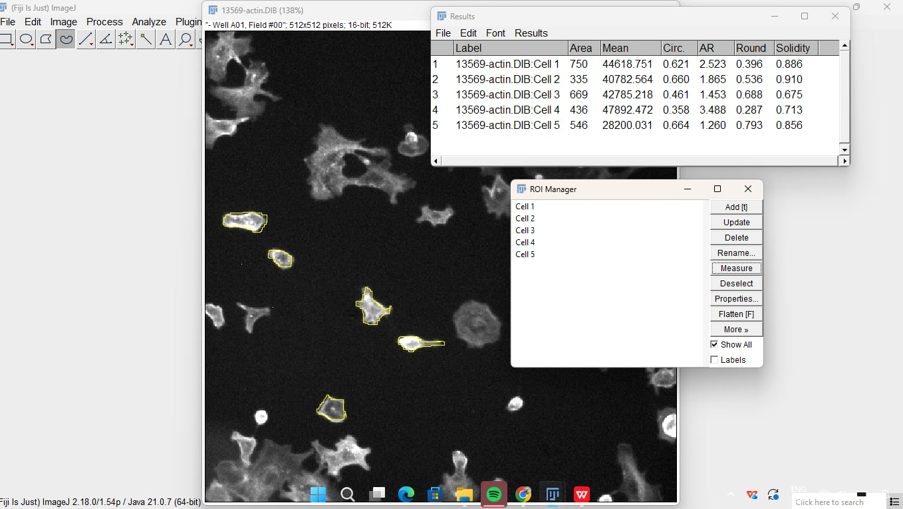
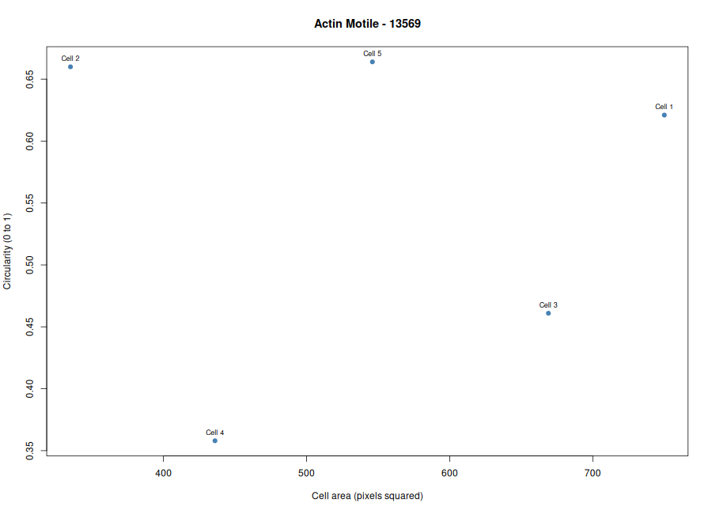
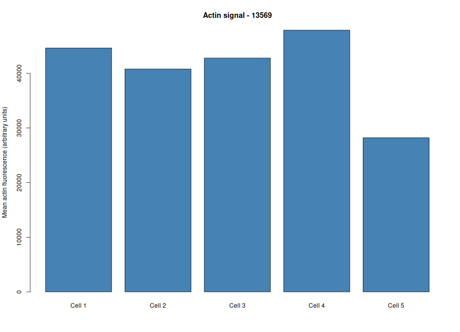

# Cytoskeleton and Cell Morphology Analysis (BBBC018)
#### Additional source: Karp Chapter 9: The Cytoskeleton and Cell Motility
#### Student ID: 202400734 
#### University Attending: Negros Oriental State University
#### Dataset: [BBBC018](https://bbbc.broadinstitute.org/BBBC018) - Human HT29 Colon-Cancer Cells
#### Selected Phenotype: Motile (appearance only) Image-Field ID: 13569

---

## Introduction
Cellular architecture dictates it's function. In this practical laboratory module, we are tasked investigated F-actin cytoskeletal distribution across HT29 human colon cancer cells using the BBBC018 benchmark dataset. Moving beyond qualitative observation, this workflow bridges microscopy and quantitative image analysis using Fiji and R to translate visual cell shapes into hard metrics like area, circularity, and aspect ratio.
The selected phenotype was Motile (appearance only). Five cells were measured using Fiji and their measurements were analyzed in R to compare cell area, circularity, aspect ratio, and mean actin fluorescence intensity.

----

## Selected Images and Datas
The fluorescence images were obtained from the Broad Bioimage Benchmark Collection ([BBBC018](https://bbbc.broadinstitute.org/BBBC018)).
- Dataset: [BBBC018](https://bbbc.broadinstitute.org/BBBC018)
- Download: [BBBC018_v1_images.zip](https://data.broadinstitute.org/bbbc/BBBC018/BBBC018_v1_images.zip)
- Phenotype: Motile (appearance only)
- Image-field ID: 13569
- Actin filename: `13569-actin.DIB`
- DNA filename: `13569-DNA.DIB`

## Procedures
### Fiji Analysis
- Opened the corresponding actin and DNA fluorescence images in Fiji using the Bio-Formats plugin.
- Inspected the cell outlines and chose five whole, non-overlapping cells to measure.
- Set up the measurement options by enabling *Area*, *Mean gray value*, *Shape descriptors*, and *Display label*.
- Used the Freehand Selection tool to carefully trace the outer edge of each cell and saved the selections into the ROI Manager.
- All five cells were measured, and the measurements were saved as `Data/fiji_results.csv`.
- The annotated fluorescence image showing the five labeled cells was saved as `Figures/Measured_cells.png` and `Figures/Measured_cells_with_annotations.png`.

### R Analysis
- Imported the saved Fiji measurements into RStudio using an R script which is provided already.
- Calculated the average cell area, circularity, aspect ratio, and actin fluorescence intensity across the five measured cells.
- Generated two graphs to visually compare cell area against circularity and to show the mean actin fluorescence intensity for each cell.

## Results
The following figures present the results of the cell morphology analysis using Fiji and RStudio. Five HT29 cells from image field 13569 were examined to determine their cell area, circularity, aspect ratio, and mean F-actin fluorescence intensity.

## Five Measured HT29 Cells
The fluorescence image was opened in Fiji, where five cells with distinguishable boundaries were selected and traced using the Freehand Selection tool. Each cell outline was added to ROI Manager, and the Show All and Labels options were enabled to display the five numbered outlines. The annotated image was then saved for documentation.

**Figure 1.A** F-actin fluorescence image of HT29 cells from field 13569, showing the five selected cells outlined and numbered using Fiji.

**Figure 1.B** F-actin fluorescence image of HT29 cells from field 13569, showing the five selected cells outlined and numbered using Fiji with it's analyzed results and ROI.

## Cell Area versus Circularity
Using the measurements obtained from Fiji, a scatter plot was generated in RStudio to examine the relationship between cell area and circularity among the five selected cells.

**Figure 2.** Scatter plot showing the relationship between cell area and circularity among the five measured HT29 cells.

The cells had areas ranging from 335 to 750 pixels², with Cell 1 having the largest area. Circularity values ranged from 0.358 to 0.664 with a mean of 0.5528. The low circularity and elevated aspect ratios (averaging 2.1178) indicate that the measured cells were polarized and elongated rather than rounded, matching the expected traits of a motile phenotype.

## Mean Actin Fluorescence Intensity
A bar graph was also generated using the provided R code to compare the mean F-actin fluorescence intensity of the five measured cells.

**Figure 3.** Bar graph comparing the mean F-actin fluorescence intensity of five HT29 cells from image field 13569.

Cell 4 showed the highest mean F-actin fluorescence intensity at 47,892.472 AU, while Cell 5 obtained the lowest at 28,200.031 AU. The average intensity across all five cells was 40,855.81 AU. These results indicate variations in F-actin fluorescence intensity among the measured cells, reflecting differences in actin concentration and cytoskeletal organization across the field.

## Cell Measurement Summary
The table below presents the average measurements of the five selected HT29 cells obtained through Fiji and analyzed using RStudio where ypu can find in `Results/cell_summary.csv`

| Measurement | Mean Value |
| :--- | :--- |
| **Cell area** | 547.20 pixels² |
| **Circularity** | 0.5528 |
| **Aspect ratio** | 2.1178 |
| **Actin fluorescence intensity** | 40,855.81 AU |

The five measured cells had an average area of 547.20 pixels², showing notable variation in size. The mean circularity of 0.5528 and aspect ratio of 2.1178 confirm that the cells were elongated and polarized. Meanwhile, the average F-actin fluorescence intensity of 40,855.81 AU represents the overall mean actin staining signal across the analyzed cells.

----

## Guide Questions

1. Which specific phenotype did you choose, and what visible features support that choice?
I selected the Motile (appearance only) phenotype. The field displays polarized, asymmetrical cells featuring prominent trailing edges and active leading protrusion structures.

2. Were your five cells mostly round or elongated? Refer to your circularity and aspect-ratio results.
The five cells were mostly elongated, with an average aspect ratio of 2.1178 (peaking at 3.488 for Cell 4) and a low average circularity of 0.5528, showing a significant deviation from a spherical shape.

3. What role does actin play in maintaining cell shape and in cell movement (Karp Chapter 9)?
Actin microfilaments provide structural support and help maintain cell shape. During cell movement, dynamic actin polymerization generates protrusive forces at the leading edge (lamellipodia and filopodia), while actomyosin contraction pulls the cell body forward.

4. Why can a single fixed fluorescence image NOT show how fast a cell moves?
A single fixed fluorescence image only captures cellular morphology at a single static point in time. Determining migration velocity requires tracking positional change over a time interval, which necessitates live-cell time-lapse imaging.

----
## Conclusion

The analysis of five HT29 cells from image field 13569 showed that the selected cells exhibited an elongated, polarized morphology consistent with a motile phenotype. With a mean aspect ratio of 2.1178 and circularity of 0.5528, quantitative metrics supported our visual observations. This activity demonstrated how fluorescence microscopy, Fiji, and R can be effectively combined to study cell morphology and actin organization.

----

## References and Data Sources

Broad Bioimage Benchmark Collection. (n.d.). [BBBC018: Human HT29 colon-cancer cells (diverse phenotypes)](https://bbbc.broadinstitute.org/BBBC018). Broad Institute. 

Ljosa, V., Sokolnicki, K. L., & Carpenter, A. E. (2012). Annotated high-throughput microscopy image sets for validation. *Nature Methods*, 9(7), 637. [https://doi.org/10.1038/nmeth.2083](https://doi.org/10.1038/nmeth.2083)

Data Credit and Image License

Data Credit: We used image set BBBC018v1 from the Broad Bioimage Benchmark Collection (Ljosa et al., Nature Methods, 2012).

Image License: Creative Commons Attribution-NonCommercial-ShareAlike 3.0 ([CC BY-NC-SA 3.0](https://creativecommons.org/licenses/by-nc-sa/3.0/)).
